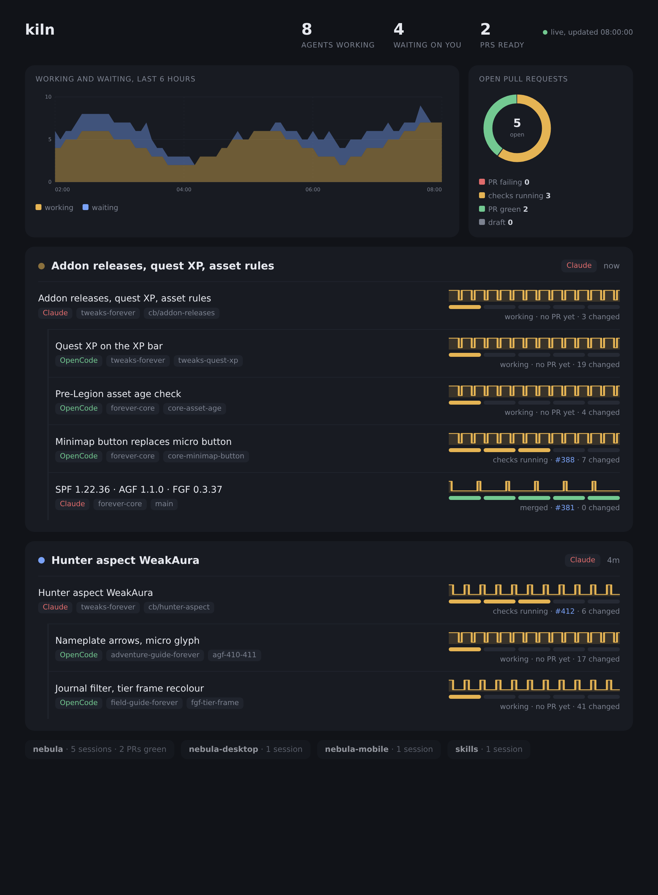
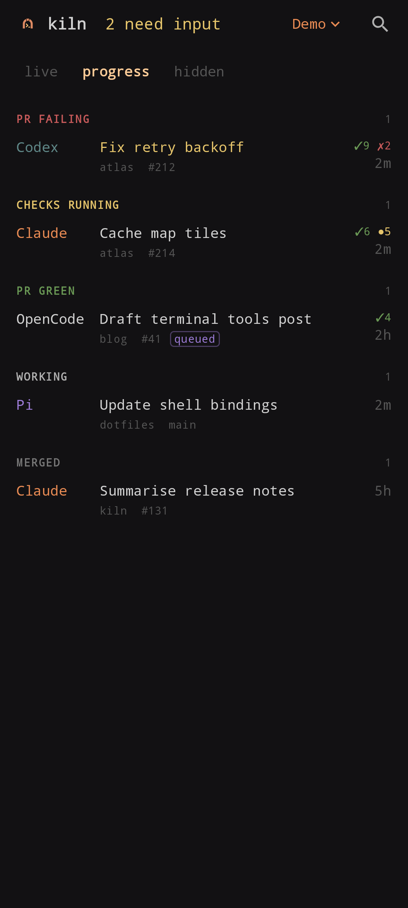
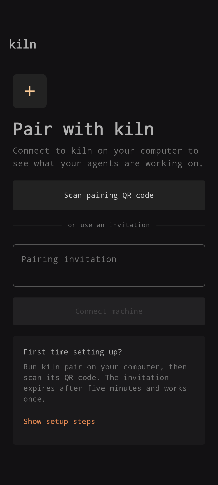

<div align="center">

<picture>
  <source media="(prefers-color-scheme: dark)" srcset="assets/wordmark-dark.svg">
  
</picture>

</div>

kiln opens native Claude, Codex, OpenCode and Pi terminal sessions and pairs with an Android client. Kiln also lists read-only Codex Cloud tasks and optional Claude cloud sessions.

Claude and Codex keep their own TUIs for messages, prompts and approvals. Kiln discovers native sessions and reads provider status updates without starting a second agent. Terminal output never establishes activity.


## Install

```sh
paru -S kiln-agents-bin # standalone binary
# or: paru -S kiln-agents # Bun source package
```

From source, install [Bun](https://bun.sh), fzf and tmux, then:

```sh
bun install --frozen-lockfile
bun start
```

Install Claude Code, Codex CLI, OpenCode or Pi, and sign in through each provider's own CLI. Native commands and their arguments can be overridden in settings.

## Set up with your agent

kiln ships three skills: `kiln-agents` lets running agents message each other and start subagents, `kiln-config` changes its TOML settings and native agent commands, and `kiln-skills` inspects and repairs shared skills. kiln syncs them into the shared skill store each time it starts. To install them before running kiln, for any agent that reads [Agent Skills](https://agentskills.io):

```sh
npx skills add cjber/kiln
```

In Claude Code you can use the plugin instead: `/plugin marketplace add cjber/kiln`, then `/plugin install kiln@kiln`. The skills live in [`skills/`](skills).

## Agents talking to each other

Any running session kiln lists can message another one:

```sh
kiln msg list                       # names, status, directory and how a message would arrive
kiln msg send codex:019a "Run the API tests on cb/login and tell me what fails"
kiln msg send --all -               # every other session, text from stdin
kiln msg inbox                      # messages kiln could not type into this session
kiln msg whoami
kiln msg spawn opencode --dir ~/repo --title "fix the tests" -- "Run the API tests and fix what fails"
```

`kiln msg spawn` starts an agent headless in kiln's tmux server, records the caller as its parent
and prints the child's kiln id. The child nests under its parent in the list, the dashboard and
`kiln msg list`, and a child messages its parent when it finishes. OpenCode runs started this way
are archived when they exit; a headless run kiln did not start is hidden after six hours idle.

Messages are kept in `$XDG_STATE_HOME/kiln/mailbox.sqlite` for seven days. Kiln puts a message in front of its recipient as a new prompt, starting with the sender's name and the command to reply:

| Recipient | Delivery |
| --- | --- |
| OpenCode on its background service | queued in OpenCode right away |
| Pi started by kiln | queued as a follow-up right away |
| Codex on its shared daemon | a new turn once it is idle |
| Claude started by kiln | pasted into its terminal once it is idle and nobody has it open |

Anything else, and a message whose recipient never becomes idle, waits for `kiln msg inbox`. Waiting messages are delivered by the next `kiln msg send`, and on each refresh of the list or the phone server while one runs. Kiln never types into a session that is working, asking a question, or open in a terminal, where it could join a prompt you are writing. A sender can send at most 20 messages to one recipient in ten minutes. The `kiln-agents` skill teaches agents to use these commands.

### Pull request messages

With `pr_messages = true` in `config.toml`, `kiln serve` (the service `kiln setup` installs) watches each session's pull requests and sends its agent a kiln message when its checks fail, naming the failed checks; when it has merge conflicts; when it gets a new review; and when it merges. A pull request's messages go to the session that opened it, or else to the most recently active session on its branch. Each message is sent once, failures and conflicts once per commit, and waits in the mailbox like any other until the agent is idle. A review message names the reviewer and verdict but never quotes them, since anyone can review a public pull request. Messages come from `kiln-autopilot`, which takes no replies. Pull requests are looked up once a minute with the GitHub CLI while this is on, whether or not a phone is open. OpenCode sessions keep their history in a database kiln does not scan, so only the pull request for their branch counts.

## Dashboard

```sh
kiln dashboard            # serves http://127.0.0.1:7438/
kiln dashboard --open     # and opens it in your browser
kiln dashboard --port 8000
```

A web page of every running session's progress, for keeping an eye on many agents at once. The header counts agents working, sessions waiting on you, and pull requests ready to merge. Each top-level session gets a card with its own lane and a lane for every child under it, showing its agent, repository, worktree, a five-step bar from working through pull request, checks, green and merged, its pull request or no PR yet, and how many files changed. Projects other than the busiest one collapse into dim pills, such as `nebula · 5 sessions · 2 PRs green`, which open when clicked. Under the header, a stacked area chart covers working and waiting agents over the last six hours with a hover readout, a donut splits every open pull request by stage, and each lane has a sparkline of when that session was working. The page keeps a light and a dark palette, pulses a lane when its stage changes, and fades a session that has been idle for 30 minutes.



A session's project is the repository its directory belongs to, so worktrees count as their repository. A session's pull requests are the one for its branch and every one it opened with `gh pr create`, read from a Claude, Codex or Pi session's transcript. Its stage comes from the most urgent of them: Working with no pull request or a closed one, PR failing when a check failed, PR checks running, PR green, and Done once it is merged. A pull request labelled for the MergeLoop queue (the `label` in `.mergepatrol/mergepatrol.yml`, `mergepatrol` by default) is marked queued. A session on `main` or `master` has no branch pull request, only the ones it opened.

The terminal list and the phone show the same stages: the list adds a `pr` column with the most urgent pull request's number, `+3` when the session has three more, coloured by stage, and each one's checks in the details line under the list; the phone has a progress tab.

The page updates itself over a server-sent event stream: session status every two seconds while it is open, uncommitted files every ten seconds, and pull requests at most once a minute per branch or pull request, fetched in the background with the GitHub CLI (`gh`). It keeps six hours of history, one sample at most every 30 seconds, for the charts and its lanes. Nothing is read while no page is open. The server listens on 127.0.0.1 only, answers only requests addressed to that name, and is separate from the phone server and its tunnel.

## Terminal

| Key | Action |
| --- | --- |
| `j` `k`, arrows | Select a session |
| `Enter` | Open a session or cloud task |
| `n` | Choose an agent, then a directory through fzf |
| `/` | Filter titles, directories, agent names and status |
| `Space` `Tab` `←` `→` | Expand or collapse children |
| `o` | Cycle list order |
| `x` | Close a kiln-owned session after confirmation |
| `s` | Edit settings |
| `S` | Open shared skills |
| `r` | Refresh |
| `q` | Quit the list |

Directory headings are orange. Sessions needing permission are yellow, ready sessions are muted green, and working sessions use subdued text. The header counts input requests even when children are collapsed. Open a yellow session to answer in the provider TUI.

Each session row carries a dim line with its repository, worktree, branch, pull request and count of changed files. An expanded session shows `⌄` in place of `›` and its children under it, each with the same line.

New sessions run inside kiln's private tmux server. `Ctrl+Q` returns to the list and leaves the session running. Existing Kitty sessions can be focused; loaded Codex daemon threads and Claude background sessions can be attached through their native commands. Sessions in other terminals show their location.

Sessions running in a terminal survive a restart of the computer. They stay in the list as `stopped`: `Enter` resumes the conversation in a new kiln session in the same directory, and `x` forgets the row and leaves the conversation with its provider. A session closed before the restart is not kept, and neither is one without a provider session id, such as a Pi started outside kiln.

Finished Claude background jobs stay in the list, marked `completed` in green or `stopped` in grey. `Enter` attaches with `claude attach`. `x` deletes a background job, running or finished, with `claude rm`, which also removes its worktree and refuses while that worktree has unpushed commits.

Kiln observes each provider's own status and never guesses from terminal output, so unknown activity stays unknown. Kiln starts Pi with a small extension that reports the session's title and whether it is working, waiting on a prompt or ready. A Pi started outside kiln is listed with `unknown` status. A session in a terminal kiln cannot open, such as a plain terminal or another tmux server, is not listed.

OpenCode status comes from its background service. Kiln starts each OpenCode session with its own `--session` id, which ties the terminal to its conversation. An OpenCode started outside kiln, in a kitty window, is listed with `unknown` status unless it was given `--session`, and a conversation still running with no known terminal is listed so `Enter` can attach to it. A session you switch to inside OpenCode, such as with `/new`, appears as its own row while it runs. Closing a session in kiln interrupts and archives it in OpenCode, and kiln never starts the service to read status.

Desktop notifications identify the session when it needs input or finishes an observed turn. Enable `notify-send` and a desktop notification service to receive them.

Cloud tasks retain their provider status and verified HTTPS links. Claude cloud tasks open in a browser. Codex Cloud tasks open a read-only CLI status/diff viewer. Cloud tasks cannot be closed or prompted from kiln.

## Settings

Press `s` to edit `~/.config/kiln/config.toml` (`$XDG_CONFIG_HOME` when set). Unknown keys are errors. Each agent command launches that agent's native TUI.

```toml
sort = "project"
detach_key = "C-q"
status_bar = true
zoxide = true
cloud = true
notifications = true
claude_cloud = false
remote_control = true

[agents]
claude = ["claude"]
codex = ["codex"]
opencode = ["opencode"]
pi = ["pi"]

[phone]
write = false
```

Set an agent command to `[]` to hide it from the new-session picker. `detach_key` and `status_bar` apply to native sessions and the Codex Cloud viewer. The status bar's session counts are shared by every attached session and refreshed at most every 15 seconds. `remote_control` enables Claude Remote Control per new session and starts Codex Remote Control on its shared daemon.

`sort` accepts `project`, `directory`, `last_active`, `age` and `harness`. `project` groups sessions by git repository, with linked worktrees under the repository that owns them; a directory outside git is its own group. Within a group, sessions are ordered by their most recent provider update, and the time since that update fades from green to grey as it ages. Branches are reread from the session directory on refresh.

Claude cloud listing is opt-in because it uses Claude's internal API. It reads an existing OAuth login and never accepts arbitrary API origins. Cloud reads are cached and refreshed asynchronously at most once per minute; provider failures retain the last successful list and show an error.

## Android

   

Install the APK from the repository's releases. To get updates on the phone, add `https://github.com/cjber/kiln` to [Obtainium](https://obtainium.imranr.dev); each release carries the same signing key. The phone lists native sessions and cloud tasks. On a computer with phone writes on, a Claude, Codex, OpenCode or Pi session opens in the app as a live conversation you can reply to, and Stop ends the turn of a Claude, Codex or Pi session kiln started. A reply sent while the agent is working waits in kiln's mailbox and is sent when the turn ends. When a session in kiln's tmux stops at a numbered menu, such as Claude's plan approval, a permission prompt, a question from Claude, or a Codex approval, the app shows the question and its answers as buttons; an answer that takes text, such as "Tell Claude what to change", sends what is in the reply box. The + button attaches files of up to 20 MB: kiln stores them under `$XDG_CACHE_HOME/kiln/uploads` for seven days, up to 500 MB in all, and the message lists their paths for the agent to open. Opening any other linked session uses the provider's installed app or browser through verified HTTPS links. Claude Remote Control and connected Codex Remote Control provide direct session links. OpenCode sessions open in OpenCode's own web UI on your computer, reached over Tailscale. Sessions without mobile access explain how to open them on the computer.

```sh
kiln setup # installs a user service that survives reboots, configures Tailscale Serve and prints a pairing QR
# In the foreground instead, until the terminal closes:
kiln serve
# With your own HTTPS tunnel instead:
kiln serve --origin https://your-machine.example
# Localhost only, without tunnel setup or a printed invitation:
kiln serve --local
# Generate another invitation while the server is running (the origin defaults to your Tailscale HTTPS name):
kiln pair
kiln pair https://your-machine.example
kiln devices
kiln revoke <device-id>
```

Sign in to Tailscale before running `kiln serve`. An existing HTTPS root serving another application is preserved; use `--origin` with a separate tunnel in that case. Keep the server running while using the phone.

`kiln setup` writes `~/.config/systemd/user/kiln-serve.service`, enables it and reports each change; running it again changes nothing. A unit that is a symlink, for example into a dotfiles repository, is left alone and reported. The service listens on localhost only and never prints a pairing code to the journal. It records the current `PATH` so the agents' CLIs are found; run `kiln setup` again after moving them. To start before login, run `loginctl enable-linger`. `--port` and `--origin` work as they do for `kiln serve`.

For OpenCode, `kiln setup` also pins OpenCode's background service to port 4096 and serves its web UI at `https://<your Tailscale name>:4096`, reachable only on your tailnet. "Open in OpenCode" then goes through kiln's own address, which signs the phone's browser in to OpenCode and opens the session; there is nothing to pair. Each link works once, for 15 minutes. Changing the port restarts OpenCode's service, so setup skips that step while a turn is running and asks you to run it again. Sessions in a terminal started with `--standalone` or `--server` belong to their own server and still open on the PC.

The progress tab groups the sessions on your computer by how far their branch has got: PR failing, checks running, PR green, working, and merged, the stage that needs you first at the top. Each row shows its project, its most urgent pull request's number and how many more it has, check counts and whether it is queued for merging; hold a row for its details, every pull request it has and a link to each open one. Pull requests are looked up with the GitHub CLI (`gh`) on the computer, only while the app is open, at most once a minute per branch or pull request.

On the phone, finished Claude background jobs show as Completed or Stopped and leave the list after a day. The phone's list opens in the order `sort` sets and orders sessions as the terminal list does.

A paired phone only watches by default. To let it start sessions and send prompts, set `write = true` under `[phone]` in `config.toml`; a phone that can do this can run code on your computer. The app then shows a New session button: choose an agent, a directory from the ones kiln already knows (the directories of listed sessions, then zoxide's list) and a first prompt of up to 16 KB. The session starts in kiln's tmux with the provider's remote control on, and it opens in the app as a live conversation. A running session's details also have a Send box, which delivers a prompt the way `kiln msg send` does and shows "Delivered" or why it waits. A phone can start 20 sessions in ten minutes, and `kiln devices` lists each phone's latest starts.

Pairing invitations expire after five minutes and work once. The phone stores its bearer token privately. The server binds to localhost, rejects browser requests and checks pairing for each request and streamed update. Keep the tunnel origin HTTPS. Revocation disconnects the phone without affecting agent sessions.

The list supports search, ordering, activity/agent filters, collapsed children and hiding sessions on that phone. Hidden rows can be restored. Saved machine connections survive upgrades.

### Notifications with the app closed

While the app is open, or while a session works, the phone keeps its own connection and notifies you when a session needs input or finishes a turn. Android closes that connection after a while in the background. To be notified with the app closed as well:

1. Install [ntfy](https://ntfy.sh) on the phone. Any [UnifiedPush](https://unifiedpush.org) distributor works.
2. In kiln, open Machines and turn on "Notify when the app is closed". Pick ntfy if Android asks.

Each paired machine then posts an encrypted message (Web Push, RFC 8291) through ntfy when a turn ends. ntfy relays ciphertext only; the session title is readable only on the phone. Revoking the phone, or turning the switch off, removes its registration from the machine.

ntfy uses the public ntfy.sh server unless you set another one in ntfy's settings. A self-hosted ntfy server on your tailnet keeps the messages off third-party servers, but then ntfy holds its own connection to that server instead of using Google's push service: it costs a little battery and shows a permanent notification.

The machine checks sessions every minute while nothing works, so a turn that starts and ends within a minute may not be noticed.

## Shared skills

Press `S` in a selected project to manage shared skills. `n` creates a skill and opens `SKILL.md` in `$EDITOR`; `Enter` edits it. Conflicting content is backed up before repair. Kiln does not overwrite unowned same-name skills.

```sh
kiln skills list
kiln skills share <name>
kiln skills sync
```

The `kiln-agents`, `kiln-config` and `kiln-skills` helpers in [`skills/`](skills) are synced into the shared store before the terminal starts.

## Verification

```sh
bunx biome ci .
bunx tsc --noEmit -p .
bun test
bun scripts/changelog.ts --check
bun scripts/list-tui-e2e.ts
bun scripts/perf.ts
bun scripts/native-tui-e2e.ts
```

The PTY tests use [Tuistory](https://github.com/remorses/tuistory) against OpenTUI, with isolated fixtures and screenshot evidence. Native handoff tests exercise direct terminal input, detach, reattach and resizing.

After visible changes, regenerate and inspect terminal and dedicated-emulator screenshots:

```sh
bun scripts/screenshots.tsx 2>/dev/null
ANDROID_HOME=/opt/android-sdk JAVA_HOME=/usr/lib/jvm/java-21-openjdk python3 scripts/android-screenshots.py
ANDROID_HOME=/opt/android-sdk JAVA_HOME=/usr/lib/jvm/java-21-openjdk android/gradlew -p android checkKotlinFormat testDebugUnitTest lintDebug assembleDebug
```
